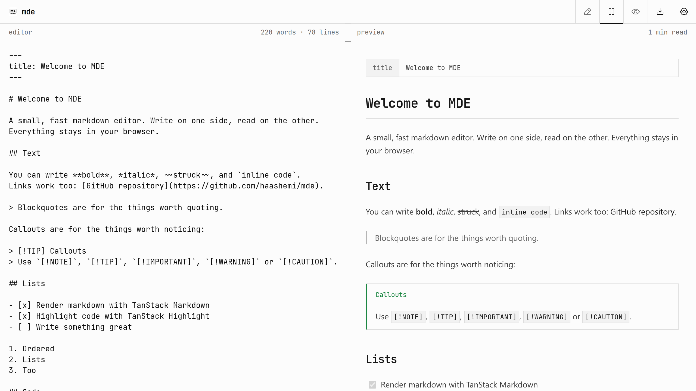

# MDE

[MDE](https://mde.haashemi.dev) is a simple web-based markdown editor with the features that you actually need.

## How it works?

It's made of just a `textarea` for input and an `article` for the rendered markdown. The markdown is rendered with [TanStack Markdown](https://github.com/TanStack/markdown) (including callouts, tabs, footnotes and frontmatter) and code blocks are highlighted with [TanStack Highlight](https://github.com/TanStack/highlight). The UI is built on [shadcn/ui](https://ui.shadcn.com). RTL support happens by changing the direction of the panels.

<picture>
  <source media="(prefers-color-scheme: dark)" srcset="./public/screenshots/wide-dark.png">
  
</picture>

## Usage

To use this project, you can use both the hosted version, or self-host it by yourself.

### Hosted version

Visit [mde.haashemi.dev](https://mde.haashemi.dev)

### Self-Host it

Self-Hosting mde is a bit way too easy. Just build it and host its build files.

```sh
# Build it
pnpm install && pnpm build
# Deploy it
pnpx serve ./dist
```
